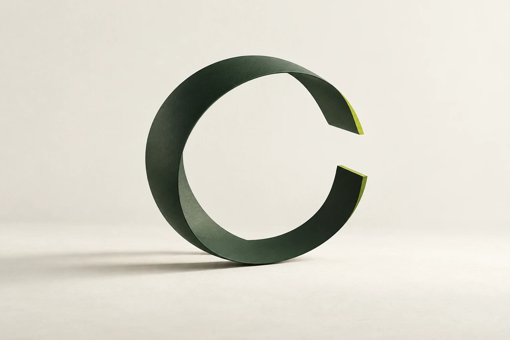
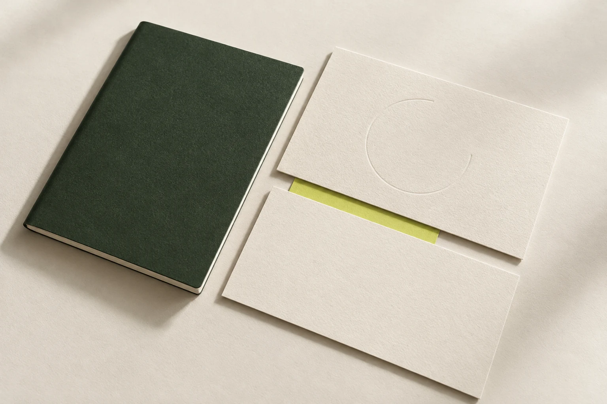
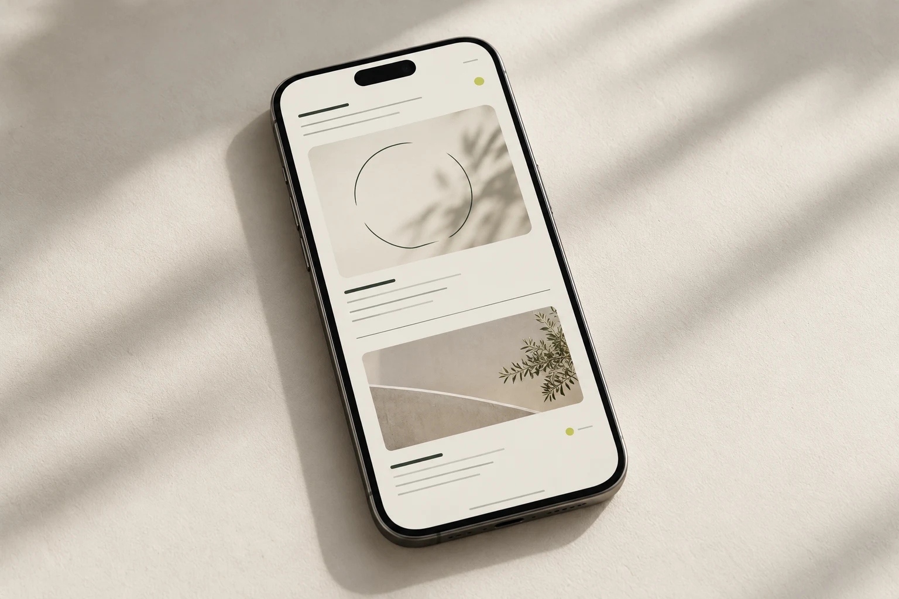

# AJAR 디자인 아이디어

2026-10-29 · 탐색용 콘셉트

브랜드 기준은 ‘열려 있는 상태 자체’다. 아래 이미지는 형태·재질·화면에 이 태도를 어떻게 적용할 수 있는지 살펴보는 시각 자료이며, 실제 제품이나 앱의 구현을 뜻하지 않는다.

## 01. 열린 윤곽

포스터나 브랜드 이미지에 쓸 수 있는 입체적 윤곽, 여백, 작은 강조색을 탐색한다. 공식 C1 로고와 구분하는 보조 그래픽이다.

## 02. 종이와 틈

따뜻한 종이, 녹색 면, 작은 라임 강조와 겹침 사이의 간격을 살펴본다.

## 03. 모바일의 여백

가벼운 정보 위계와 넓은 간격, 얇은 구분선으로 AJAR의 태도를 화면에 적용하는 아이디어다.

원본과 프롬프트는 [에셋 폴더](../brand/assets/ideas/)에서 확인할 수 있다.
