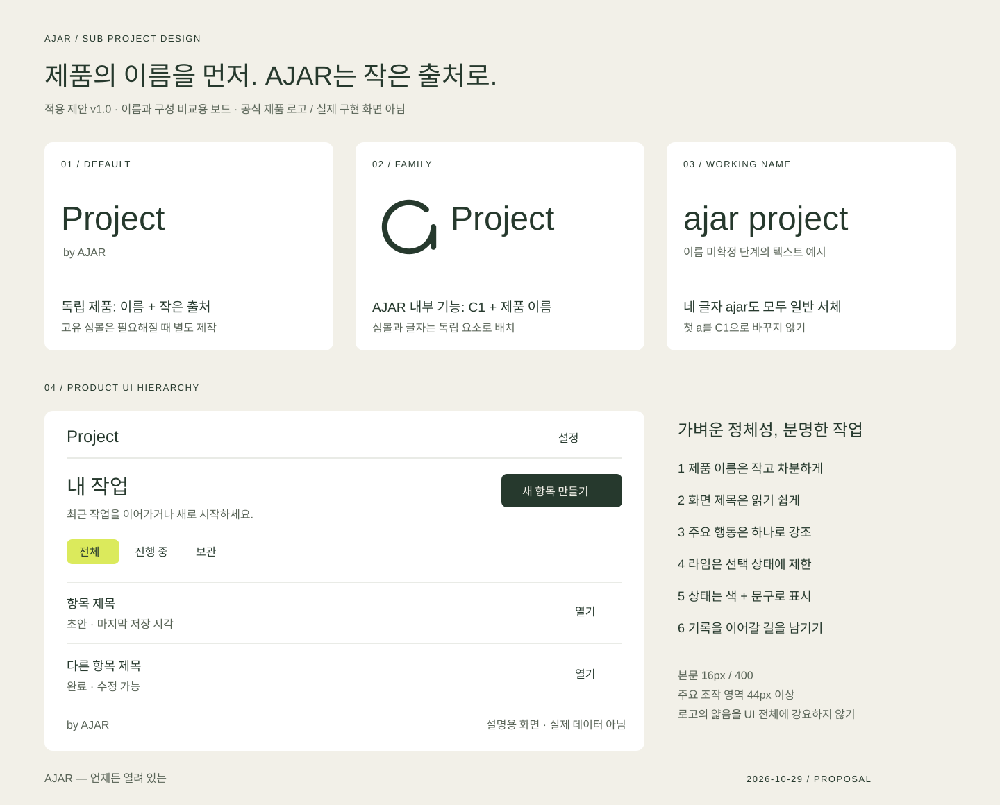

# AJAR Sub Project Design Guide v1.0

작성: 2026-10-29 · 상태: **적용 제안**  
기준: [Brand Definition v1.2](brand-draft.md) · [BI v1.3](brand-identity.md)

> AJAR — 언제든 열려 있는  
> 프로젝트의 목적과 이름은 또렷하게, 새로운 생각과 다음 변화가 들어올 여지는 남긴다.

이 문서는 서브 프로젝트를 시작할 때 복사해 쓸 로고·UX·UI 기준이다. 기존 승인된 AJAR 자산은 그대로 사용하며, 아래의 제품 규칙·수치는 첫 적용을 위한 제안이다. `ajar-project`는 조합 설명용 이름이다. 동일 이름의 실제 저장소·기능·화면은 확인하지 않았으며 제품 감사를 수행한 문서는 아니다. 다른 저장소를 수정하거나 자동 동기화하지 않는다.



## 1. 브랜드 구조: 제품 이름이 먼저, AJAR는 출처로

**권장 기본형은 ‘독립 제품 이름 + 작은 by AJAR’다.** 사용자에게 필요한 것은 지금 쓰는 제품이 무엇을 하는지 아는 것이다. AJAR와의 관계는 소개·로그인·설정·푸터에서 확인할 수 있게 한다.

| 상황 | 권장 표기 | 이유 |
| --- | --- | --- |
| 저장소·패키지 | `ajar-<slug>` | 운영 식별자. 그대로 제품 로고가 될 필요는 없다 |
| 사용자 대상 제품 | `Project` + `by AJAR` | 제품과 모브랜드의 역할을 분리한다 |
| 임시 이름으로 출시 준비 | `ajar project` 전체를 서체로 조판 | 이름 미확정 상태의 임시 표기. 모두 일반 글자다 |
| AJAR 자체를 관리하는 내부 도구 | C1 + `Project` | AJAR의 기능 확장일 때만 가족형 조합을 사용한다 |
| 문서·소개 문장 | `Project — an AJAR project` | 관계를 설명하는 문장으로 쓴다 |

실제 제품명은 대상 사용자와 핵심 효용을 정한 뒤 결정한다. 저장소 이름의 하이픈이나 대문자 규칙을 제품 화면에 기계적으로 옮기지 않는다. `by AJAR`는 출처 표기이며 공식 슬로건을 대체하지 않는다.

## 2. 로고: 공통 C1과 제품 식별을 분리한다

### 기본 추천

- 초기에는 **별도 심볼을 억지로 만들지 않고 제품 이름만으로 시작**한다. 영문 이름은 Outfit 300, 작은 이름은 400을 제안한다. 한글 이름은 본문과 같은 한글 서체 400을 사용한다.
- 첫 화면·소개에서는 제품 이름 아래에 `by AJAR`를 12–14px, 400으로 작게 둔다. 기능 화면에서는 제품 이름만 남겨도 된다.
- AJAR의 이름을 로고로 보여줄 때는 제공된 전체 `ajar` 워드마크 SVG를 쓴다. 출처 문장 속 `AJAR`는 일반 텍스트다.
- C1을 제품 이름의 첫 a로 끼우지 않는다. C1과 `jar project`를 붙이는 방식은 사용하지 않는다.
- AJAR C1의 원호·열린 각도·끝·선 굵기·짧은 직선은 바꾸지 않는다. 글자·음표·숫자·배지를 심볼 안에 넣거나 열린 틈을 메우지 않는다.

### 가족형 조합이 필요한 경우

C1과 제품 이름을 독립 요소로 배치한다. 공식 C1 + ajar 조합은 이미 정해진 비율을 유지하고, 제품명과의 새 조합은 **별도 제품 조합**으로 표시한다. 기존 공식 lockup을 늘리거나 일부 글자를 삭제해 만들지 않는다.

제품 조합의 시작값: 심볼 실제 윤곽 높이를 H로 잡고 이름의 실제 보이는 높이를 0.65–0.75H, 사이 간격은 0.32H 이상으로 둔다. j·g 등의 아래획까지 포함해 눈으로 중심을 맞춘다. 제품 이름이 길어지면 이름을 여러 줄로 나누기보다 심볼을 생략하고 텍스트 이름을 사용한다. 이 비율은 확정된 새 로고 원본이 아닌 조판 출발점이다.

### 사용 위치와 최소 크기

| 위치 | 선택 |
| --- | --- |
| 랜딩·소개 표지 | 제품 이름 + 작은 by AJAR. 공식 AJAR 로고는 별도 영역 |
| 앱 상단 | 20–24px 제품 이름 또는 승인된 제품 워드마크. 좁으면 심볼 중복 생략 |
| 설정·정보·푸터 | 제품 버전, by AJAR, AJAR 소개 링크 |
| 앱 아이콘·파비콘 | 제품이 하나일 때 기존 C1 패키지를 임시로 사용할 수 있다 |
| 여러 제품이 나란히 설치되는 환경 | 제품별 고유 심볼을 만든다. C1은 모브랜드 식별에 유지 |

AJAR 공식 파일의 여백 포함 최소 폭은 심볼 24px, 워드마크 120px, 공식 가로 조합 200px이다. 공간이 부족하면 공식 워드마크를 임의로 줄이지 않고 일반 제품 이름 또는 심볼 단독을 선택한다. 16/32px 파비콘에는 제공된 축소 보정 파일을 쓴다.

여러 제품에 같은 C1·같은 바탕을 쓰면 홈 화면에서 구별하기 어렵다. **보조색만 바꾸는 것은 임시 대응**이다. 고유 제품 심볼을 만들 때는 기능에서 출발한 단순한 형태, 열린 윤곽, 한 가지 선 체계를 참고할 수 있지만 C1의 파생 로고로 주장하지 않는다. 별도 SVG 원본과 축소 검토가 필요하다.

## 3. 무엇을 공유하고 무엇을 바꿀까

| 고정 | 제품별로 선택 | 별도 검토 후 변경 |
| --- | --- | --- |
| AJAR 정의·공식 C1·전체 워드마크 | 제품 이름·설명·정보 구조 | 새 제품 심볼과 제품 조합 원본 |
| 본문 가독성·조작 피드백·접근성 | 기능에 맞는 밀도·콘텐츠·사진 | 한글 배포 서체·다크 테마 |
| 명료한 문장·여백의 위계 | 보조 강조색 1개·데이터 시각화 | 인쇄 색상·스토어 최종 아이콘 |

모든 제품을 녹색 화면으로 만들 필요는 없다. 초기 공통 테마는 Paper / Moss / Lime으로 시작하고, 제품 차별화가 필요하면 강조색 하나를 바꾼다. `brand`와 `action`, `success`, `warning`, `danger`는 별도 의미 토큰으로 관리한다. 라임은 브랜드 강조색이며 성공·저장 완료를 자동으로 뜻하지 않는다.

## 4. UX: 열려 있음을 사용 경험으로 옮기기

| 브랜드 태도 | 제품에서의 행동 | 피할 것 |
| --- | --- | --- |
| 생각의 여지 | 나중에 수정, 미리보기, 취소·되돌리기 | 첫 입력을 영구 확정하기 |
| 형태의 유연함 | 최소 정보로 시작하고 필요한 설정은 이후에 | 가입 직후 긴 필수 설문 |
| 이어갈 가능성 | 초안·최근 작업·재개 지점 보존 | 오류 후 입력 초기화, 자동 만료 압박 |

‘열려 있음’은 메뉴를 전부 펼쳐 놓는다는 뜻이 아니다. **화면의 주요 행동은 하나로 분명하게**, 보조 행동은 가까운 곳에 둔다. 권한·공개 범위·저장 위치는 명확히 설명하고, 선택 사항은 건너뛸 수 있게 한다.

### 기본 흐름

1. **진입:** 한 문장으로 효용과 시작 버튼을 제시한다. 계정이 불필요한 탐색은 먼저 허용한다.
2. **첫 행동:** 실제 핵심 작업 하나를 완료하게 한다. 샘플은 사용자 데이터와 구분한다.
3. **완료:** 무엇이 어디에 저장됐는지와 다음 행동을 보여준다.
4. **재방문:** 최근 항목과 이어하기를 먼저 제공한다. 빈 홍보 화면을 반복하지 않는다.
5. **실패·이탈:** 입력과 진행 상태를 보존하고 재시도·나중에 계속할 방법을 제공한다.

자동 저장은 실제 구현됐을 때만 표시한다. `저장 중` → 서버 확인 뒤 `저장됨`, 실패하면 `저장하지 못했어요`와 재시도. 오프라인 로컬 보관은 서버 동기화와 구별한다. 충돌 시 마지막 입력을 조용히 덮어쓰지 않는다.

### 정보 구조 시작안

- 주요 목적지는 최대 3–5개로 시작한다. 숫자는 절대 규칙이 아니며 사용자 과업으로 검토한다.
- 목록 → 상세 → 편집 흐름을 기본으로 하고 필터·정렬은 목록 가까이에 둔다.
- 검색은 항목이 늘거나 사용자가 특정 대상을 찾을 때 도입한다.
- 모바일 하단 탐색은 자주 전환하는 동급 목적지에만 사용한다. 저장·삭제 같은 실행 버튼과 섞지 않는다.
- 뒤로 가기·브라우저 기록·직접 링크가 예상대로 동작해야 한다. 편집 이탈 시 변경 보존 또는 명확한 선택을 제공한다.

## 5. UI: 절제된 브랜드, 읽기 쉬운 기능 화면

### 서체

| 역할 | 기본값 | 원칙 |
| --- | --- | --- |
| 공식 AJAR 워드마크 | 제공 SVG / Outfit 300 | 형태와 비율 고정 |
| 큰 영문 브랜드 제목 | 32–48px / 300 / 1.2 | 랜딩·표지 중심 |
| 제품 화면 제목 | 24–32px / 400 / 1.35 | 얇음보다 식별성 우선 |
| 섹션 제목 | 18–20px / 500 / 1.4 | 짧고 구체적으로 |
| 본문·입력 | 16px / 400 / 1.6 | 긴 한글은 최대 약 65자 폭 |
| 버튼·주요 라벨 | 14–16px / 500 / 1.4 | 작은 Light 글자 금지 |
| 보조 정보 | 12–14px / 400 / 1.5 | 핵심 지시를 이 크기에 숨기지 않기 |

영문은 Outfit, 한글은 현재 BI의 시스템 스택을 사용한다. 한글 전용 배포 서체는 아직 미확정이다. 한글을 인위적으로 가늘게 하거나 큰 음수 자간으로 조이지 않는다. 긴 이름·번역·숫자·200% 글자 확대를 확인한다.

### 레이아웃·형태

- 간격 단위: 4 / 8 / 12 / 16 / 24 / 32 / 48 / 64px.
- 모바일 좌우 여백 20px(좁은 320px 화면은 16px), 데스크톱 32px 이상. 일반 최대 폭 1120px, 읽기 화면은 약 680px.
- 720px을 시작 분기점으로 삼되 실제 콘텐츠가 무너지면 조정한다. 320px에서도 기본 작업에 가로 스크롤이 없어야 한다. 넓은 표는 별도 스크롤 영역과 제목을 둔다.
- 입력·주요 버튼 높이는 최소 44px, 모바일 주요 행동은 48px을 권장한다. 시각적 아이콘이 20px여도 클릭 영역은 44px 이상 확보한다.
- 모서리: 입력·버튼 8px, 카드 12px, 큰 패널 16px. 모든 요소를 알약 모양으로 만들지 않는다.
- 콘텐츠는 여백·얇은 선으로 구분하고, 묶음이 실제로 필요할 때 카드를 쓴다. 카드 안에 카드를 반복하지 않는다.
- 그림자는 떠 있는 메뉴·대화상자에 한정한다. 얇은 선이 없어도 정보 위계가 읽혀야 한다.

### 색상·대비

기본 Paper `#F2F0E8`, Surface `#FFFFFF`, Text/Action `#26392D`, Accent `#DBEA5C`. 보조 글자 `#596457`, 입력 경계 `#7B8877`, 구분선 `#D3D8CD`를 제안한다. 구분선은 장식용이며 입력 경계를 대신하지 않는다.

기본 주요 버튼은 Moss 바탕·Paper 글자, 보조 버튼은 투명 바탕·Moss 글자/경계. 라임은 선택된 필터나 짧은 강조에 Moss 글자와 함께 사용한다. 흰색/라임 또는 Paper/라임 본문 조합은 사용하지 않는다.

기본 상태색 제안: Success `#27633D`, Warning `#80500B`, Danger `#A12B32`, Info `#285B7A`. 밝은 바탕에 해당 색의 텍스트·아이콘을 사용하고 반드시 상태 문구를 병기한다. 색만으로 성공/오류/선택을 구분하지 않는다. 보조색을 바꾸면 실제 조합의 대비를 다시 측정한다.

### 모션

일반 피드백 120–180ms, 패널 전환 180–240ms를 시작값으로 쓴다. 진행 대기를 줄이는 척하는 가짜 진행률은 쓰지 않는다. `prefers-reduced-motion`에서는 장식 이동·심볼 그리기를 제거한다. 반짝임·무한 브랜드 애니메이션보다 작업 완료와 상태 변화를 설명하는 움직임을 우선한다.

## 6. 컴포넌트와 필수 상태

| 요소 | 기본 규칙 | 반드시 설계할 상태 |
| --- | --- | --- |
| 버튼 | 화면당 주요 CTA 하나, 동사 중심 이름 | 기본·hover·focus·pressed·disabled·loading |
| 입력 | 항상 보이는 라벨, 예시와 설명 분리 | 기본·focus·입력됨·오류·비활성·읽기전용 |
| 목록 | 제목·주요 정보·다음 행동의 순서 고정 | 로딩·빈 목록·검색 결과 없음·오류·다음 페이지 |
| 상세·편집 | 저장 위치와 편집 여부 명확히 | 로딩·저장 중·완료·실패·권한 없음·충돌 |
| 대화상자 | 필수 확인이 있을 때만, 취소 제공 | 초점 진입·Tab 순환·Escape·닫은 뒤 초점 복귀 |
| 알림 | 핵심 결과는 화면에도 남김 | 성공·경고·실패, 스크린리더 전달 |
| 탐색 | 현재 위치를 텍스트/형태로 구분 | 현재·키보드 focus·좁은 화면 |

로딩 중에도 현재 내용이 있으면 유지한다. 중복 제출은 막되 버튼 이름과 처리 상태를 전달한다. 실패한 입력 옆에 원인·해결법을 쓰고 값은 유지한다. 비활성 버튼만 보여주지 말고 필요한 조건을 설명한다. 빈 목록은 ‘첫 항목 만들기’, 검색 결과 없음은 ‘조건 지우기’처럼 원인에 맞는 행동을 제시한다.

삭제는 복구 가능하면 취소 시간을 제공하고, 복구 불가·영향이 큰 경우 대상과 결과를 명시해 확인받는다. 오류 설명은 토스트 한 번으로 끝내지 않는다.

## 7. 접근성·문장

웹은 WCAG 2.2 AA를 검토 기준으로 삼는다. 아래 수치를 맞추는 것만으로 준수가 검증되는 것은 아니다.

- 일반 텍스트 대비 4.5:1 이상, 큰 텍스트(24 CSS px 또는 약 18.7px 굵은 글자) 3:1 이상. 의미 있는 UI 경계·상태 그래픽은 인접 색과 3:1을 확인한다.
- W3C의 포인터 대상 최소 기준은 예외 조건을 포함한 24×24 CSS px이다. 이 가이드는 제품 목표로 더 넓은 44×44px을 사용한다.
- 키보드만으로 주요 흐름 완료, 보이는 focus, sticky 영역에 가려지지 않는 초점, 논리적인 이동 순서를 확인한다. 단순 outline 제거 금지.
- 웹 기본 버튼·링크·입력 의미를 유지한다. 아이콘 버튼에는 이름, 입력에는 연결된 라벨, 오류에는 연결된 설명을 둔다.
- 메뉴·대화상자는 초점을 관리하고, 상태 변화는 적절한 live region으로 전달한다. 지속적으로 반복 낭독하지 않는다.
- 이미지 속 문장 대신 실제 텍스트를 쓴다. 의미 있는 그림에는 대체 설명, 장식 그림에는 빈 alt를 사용한다.
- 터치·키보드 대안 없이 drag나 hover만으로 핵심 작업을 제공하지 않는다.

참고: [W3C WCAG 2.2](https://www.w3.org/TR/WCAG22/), [텍스트 대비](https://www.w3.org/WAI/WCAG21/Understanding/contrast-minimum), [Target Size](https://www.w3.org/WAI/WCAG22/Understanding/target-size-minimum).

문장은 짧고 구체적으로 쓴다. 버튼은 `확인`보다 `기록 저장`, 오류는 `문제가 발생했습니다`보다 `연결이 끊겨 저장하지 못했어요. 입력은 이 화면에 남아 있어요.`처럼 실제로 보장되는 사실과 다음 행동을 알려준다. 보존이 구현되지 않았다면 보존됐다고 쓰지 않는다. 슬로건은 소개에 사용하고 기능 안내마다 반복하지 않는다.

## 8. 시작용 토큰과 예시

- [UI 토큰 CSS](assets/bi/subprojects/ajar-product-tokens.css): 직접 복사해 프로젝트에서 버전 관리한다. 네트워크 의존성·자동 업데이트는 만들지 않는다.
- [조합·화면 구조 보드](assets/bi/subprojects/subproject-design-board.svg): 제품 이름 우선 / 가족형 / 기능 화면의 위계를 비교하는 벡터 설명이다. 출시용 새 로고나 구현된 제품 화면은 아니다.
- [브랜드 자산](../brand/assets/)과 [플랫폼 아이콘 안내](../brand/assets/icons/README.md)는 공식 원본이다. 제품마다 다른 앱 아이콘이 필요하면 별도 제작한다.

CSS는 의미 토큰과 소수의 예제 클래스만 제공하며 완성된 컴포넌트 라이브러리가 아니다. 제품의 기존 CSS와 충돌하지 않도록 `.ajar-ui`로 범위를 한정한다. 기존 앱에 통째로 덮어쓰지 않는다. 다크 테마는 이 버전에서 정의하지 않았으며 단순 색 반전으로 추가하지 않는다.

## 9. 프로젝트별로 먼저 채울 결정표

```text
제품 이름 / 저장소:
누구의 어떤 문제를 해결하는가:
가장 중요한 사용자 행동 1개:
주요 목적지와 진입 → 완료 → 재방문 흐름:
브랜드 방식: 제품 이름 + by AJAR [기본] / AJAR 가족형
로고: 텍스트 이름 / 승인된 제품 심볼
앱 아이콘: 임시 C1 / 제품 고유 심볼 (중복 설치 시 필요)
테마: 공통 팔레트 / 보조색 1개 (HEX·대비 검증 결과)
데이터 저장·동기화·오프라인·복구 정책:
핵심 화면과 상태 목록:
지원 기기·브라우저·언어:
선택한 가이드 버전 / 변경 이유 / 검토일:
```

`ajar-project`의 목적이 AJAR 자체의 프로젝트 관리라면 가족형 C1 + Project가 어울린다. 독립 사용자 제품이라면 제품 이름 + by AJAR를 우선한다. 실제 용도가 확인되기 전에는 이름·심볼·탐색 메뉴를 확정하지 않는다.

## 10. 적용 순서와 완료 기준

1. 위 결정표와 핵심 사용자 흐름을 채운다.
2. 이름 중심의 로고 구조를 고르고 기존 C1·워드마크와 충돌하는지 확인한다.
3. 핵심 화면 하나를 실제 콘텐츠로 만들고 빈 상태·로딩·오류·성공을 함께 설계한다.
4. 같은 구조를 나머지 화면에 적용하고 반복 요소를 컴포넌트로 묶는다.
5. 320px 모바일·넓은 화면·긴 이름·200% 확대·키보드·스크린리더·동작 줄이기를 확인한다.
6. 대비·focus·라벨·입력 보존·중복 제출·삭제 복구를 확인하고 검증하지 못한 항목을 기록한다.
7. `docs/design.md`에 선택한 버전·제품별 예외·로고 파일·토큰·실제 화면을 기록한다.

실제 사용자에게 핵심 행동을 설명 없이 해보게 하고, 막힌 위치와 문구를 고친다. 이 문서는 가이드 작성 단계이며 개별 제품의 사용성 검증이나 접근성 적합 판정을 완료한 기록은 아니다.
